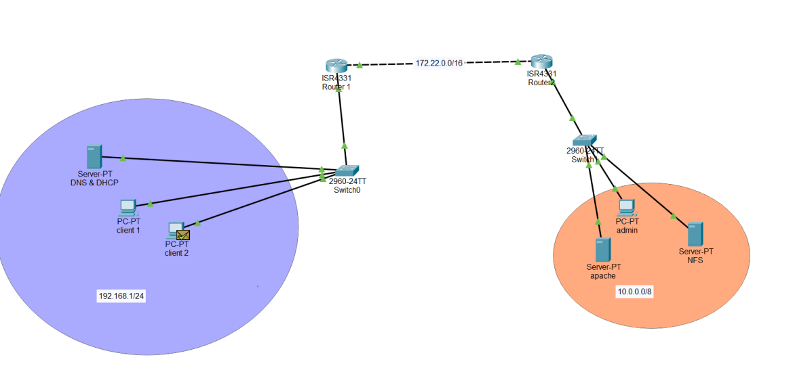
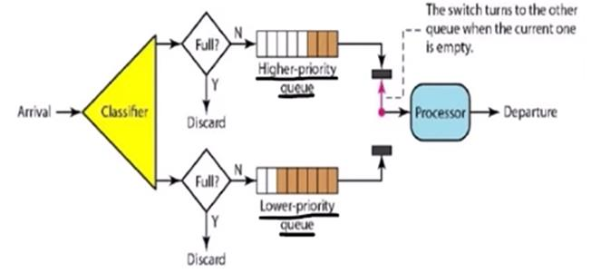

# Linux Network QoS & Traffic Control: FIFO, Priority Queuing, and Weighted Fair Sharing Under Congestion

A multi-subnet routed network designed in **Cisco Packet Tracer** and fully deployed in a **VMware Linux** testbed (Ubuntu & Kali Linux) to evaluate, measure, and compare network Quality of Service (QoS) strategies under artificial network congestion.

Using Linux kernel traffic control (`tc`), the **Hierarchical Token Bucket (HTB)** scheduler, **Stochastic Fairness Queueing (SFQ)**, and **iptables packet marking**, this lab measures the concrete trade-offs between default FIFO, Strict Priority Queuing (PQ), and Weighted Queuing Sharing (WQS).



| | |
|---|---|
| **Author** | Ali Harti |
| **Co-Authors** | Yasser Bouhha, Chaimaa Rady, Yahya Sba |
| **Environment** | VMware Workstation (Ubuntu / Kali Linux), Cisco Packet Tracer |
| **Tools** | Linux `tc`, `iptables`, `iperf3`, `hping3`, `tcpdump`, `bind9`, `apache2`, `nfs` |
| **Report** | [`docs/Rapport_Systeme_Gestion_QoS_Reseaux.pdf`](docs/Rapport_Systeme_Gestion_QoS_Reseaux.pdf) (French, 56 pages) |

## Results at a Glance

All three scenarios were subjected to identical network saturation using multi-threaded `hping3` TCP/ICMP flooding and simultaneous background HTTP and NFS requests across the core router:

| Metric | Scenario 1: FIFO (No QoS) | Scenario 2: Priority Queuing (PQ) | Scenario 3: Weighted Sharing (WQS) |
|---|---|---|---|
| **UDP Loss %** | **36.6%** (severe degradation) | **0.0%** (fully protected) | **0.42%** (near-zero loss) |
| **UDP Jitter** | **378.7 ms** | **0.38 ms** | **0.78 ms** |
| **UDP Throughput** | 277 kbps (collapsed) | 500 kbps (100% nominal) | 482 kbps (96.4% nominal) |
| **TCP Packets Dropped** | Uncontrolled | **680,814 drops** (starvation) | **5,381 drops** (**-99.2% drop reduction**) |
| **Service Balance** | Both degrade | TCP starved for UDP | **Fair coexistence across all flows** |

### Key Experimental Insights

1. **FIFO Failure Under Congestion**: Without active queue management, buffer bloat and packet drops degrade real-time traffic indiscriminately. UDP jitter spikes to 378.7 ms and packet loss exceeds 36%.
2. **The "Priority Inversion" Cost**: Strict Priority Queuing (`prio 0` for UDP vs `prio 5` for TCP) perfectly protects time-sensitive streams, but completely starves bulk TCP flows, causing over **680,000 dropped packets**.
3. **The WQS Compromise**: Weighted Queuing Sharing with Stochastic Fairness Queueing (`sfq`) allocates proportional bandwidth (700 kbps UDP / 300 kbps TCP) and reduces TCP packet drops by **99.2%** while maintaining 99.58% UDP delivery and sub-millisecond jitter.


*Figure: Mechanism of Strict Priority Queuing vs Weighted Sharing.*

## Architecture

The virtualized environment simulates an enterprise topology across three isolated subnets connected via two Linux routers:

```
[ Clients LAN: 192.168.1.0/24 ]
  ├── Client 1 & 2 (DHCP dynamic lease)
  ├── DNS / DHCP Server (192.168.1.3: BIND9 + ISC-DHCP)
  └── Router 1 - ens33 (192.168.1.1/24)
            │
[ Transit Link: 172.22.0.0/30 ]
  ├── Router 1 - ens37 (172.22.0.1/30) [QoS Enforcement Point]
  └── Router 2 - ens33 (172.22.0.2/30)
            │
[ Servers & Admin LAN: 10.0.0.0/24 ]
  ├── Router 2 - ens37 (10.0.0.1/24)
  ├── Web Server (Apache2 on 10.0.0.4)
  ├── NFS Server (10.0.0.2, export: /home/yasser/partage)
  └── Admin / Monitoring Host (10.0.0.101)
```

Full IP plans, Netplan configs, and service configurations are detailed in [`docs/architecture-and-config.md`](docs/architecture-and-config.md).

## Reproduction & Scripts

All QoS policies and test scripts are self-contained in [`scripts/`](scripts/):

### 1. Apply Strict Priority Queuing (PQ)
```bash
sudo ./scripts/priority.sh eth1
```
Marks client UDP traffic with `MARK 10` and TCP/ICMP with `MARK 20`. Directs mark 10 to HTB class `1:10` (`prio 0`) and mark 20 to `1:20` (`prio 5`).

### 2. Apply Weighted Queuing Sharing (WQS)
```bash
sudo ./scripts/fairsharing.sh eth1
```
Allocates a 70% rate share (700 kbps) to UDP and 30% (300 kbps) to TCP with SFQ stochastic fair distribution to prevent connection starvation.

### 3. Generate Congestion & Measure
```bash
sudo ./scripts/congestion-test.sh 172.22.0.2 10.0.0.101 10.0.0.2
```

### 4. Reset & Evaluate
```bash
sudo ./scripts/reset-qos.sh eth1
python3 results/evaluate_qos.py
```

## Evidence & Verified Outputs

Screenshots captured directly from the testbed during experimental runs:

| Check | Description | Screenshot Evidence |
|---|---|---|
| Priority Config | HTB priority classes script in nano | [fig32-qos-priority-config.png](images/evidence/fig32-qos-priority-config.png) |
| WQS Config | Weighted sharing script with SFQ | [fig33-qos-wqs-config.png](images/evidence/fig33-qos-wqs-config.png) |
| Congestion Flood | Multi-terminal hping3 and curl flood | [fig36-traffic-injection.png](images/evidence/fig36-traffic-injection.png) |
| FIFO Collapse | 36.6% loss and 378 ms jitter on UDP | [fig38-fifo-congestion-udp-loss.png](images/evidence/fig38-fifo-congestion-udp-loss.png) |
| Priority TCP Drops | `tc -s class show` reporting 680k dropped packets | [fig40-priority-tcp-drops.png](images/evidence/fig40-priority-tcp-drops.png) |
| WQS Stabilization | Drops reduced to 5.3k under WQS | [fig41-wqs-tcp-drops.png](images/evidence/fig41-wqs-tcp-drops.png) |
| WQS UDP Throughput | iperf3 demonstrating 482 kbps stability | [fig42-wqs-udp-bandwidth.png](images/evidence/fig42-wqs-udp-bandwidth.png) |

## Repository Layout

```
.
├── README.md
├── LICENSE
├── .gitignore
├── scripts/
│   ├── priority.sh           # Strict Priority Queuing (PQ) via tc HTB + iptables
│   ├── fairsharing.sh        # Weighted Queuing Sharing (WQS) via tc HTB + SFQ
│   ├── congestion-test.sh    # Multi-stream traffic flood generator
│   └── reset-qos.sh          # Flush tc qdisc and iptables mangle table
├── results/
│   ├── qos-performance-metrics.csv  # Raw benchmark metrics from the report
│   └── evaluate_qos.py              # Performance evaluation summary script
├── docs/
│   ├── Rapport_Systeme_Gestion_QoS_Reseaux.pdf   # Complete 56-page technical report
│   └── architecture-and-config.md               # Addressing, routing & VM service setup
└── images/
    ├── topology.png                             # Full logical topology
    ├── priority-queuing-diagram.png             # PQ queue mechanism diagram
    ├── weighted-fair-queuing-diagram.png        # WQS queue mechanism diagram
    └── evidence/                                # Benchmark screenshots (figures 32-42)
```

## Author

Ali Harti. Co-authored with team members Yasser Bouhha, Chaimaa Rady, and Yahya Sba.
